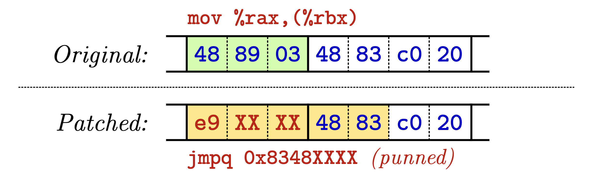
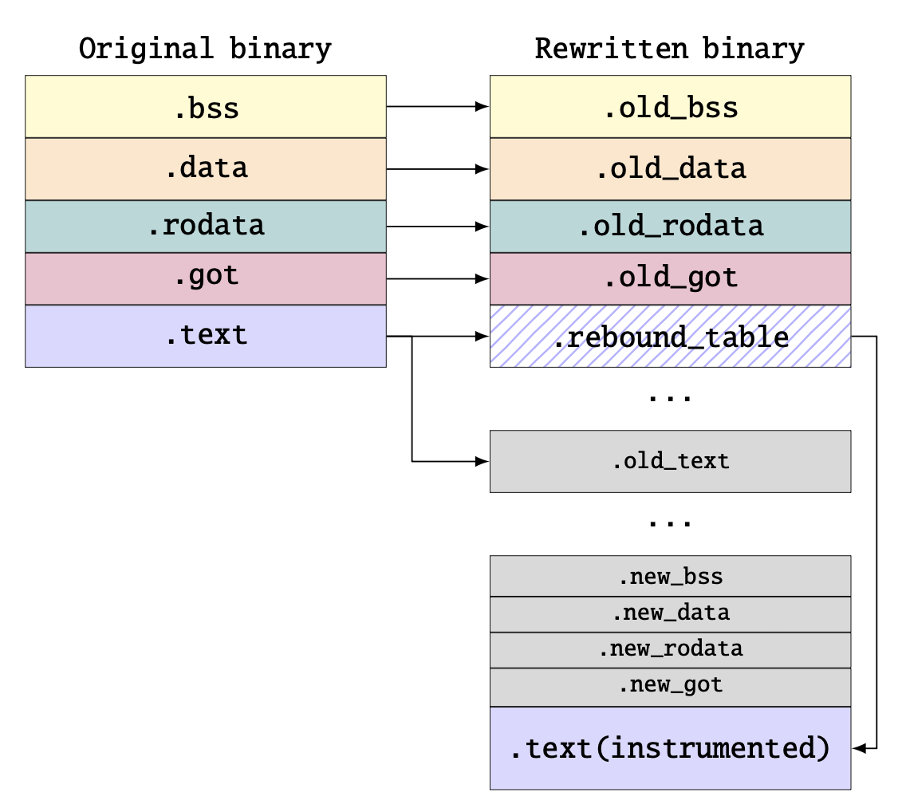
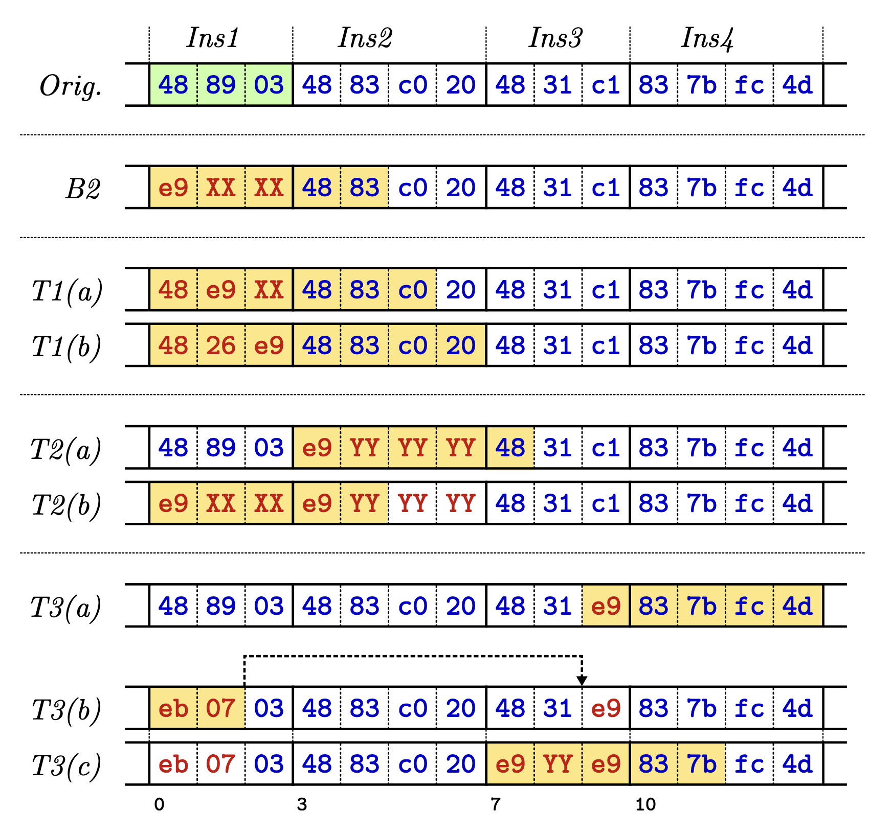

# Binary Rewriting across different Architectures

This blog post is the result of a seminar paper I wrote during my studies at TU Darmstadt in a course offered by [SEEMOO](https://www.seemoo.tu-darmstadt.de/teaching/seminars/).

Binary rewriting allows the modification of compiled binary files without source code, enabling use cases such as fuzzing or hardening of proprietary binaries. However, differences in instruction set architectures (ISAs) and challenges in disassembling, pointer recovery, or distinguishing between code and data make it difficult to develop generic rewriting tools. This paper collects recent binary rewriting tools for various architectures, analyzes their underlying techniques and compares them. Across the different architectures, two strategies were identified: trampoline-based and symbolization-based. While the trampoline-based approaches are all sound, they also introduce a huge performance overhead, making them less suitable for use cases like fuzzing. In contrast, symbolization-based approaches tend to have a small overhead, but often at the cost of soundness or the use of architecture-specific features. The identified rewriting tools were then evaluated based on robustness, performance overhead, availability of artifacts, and architectural constraints. The comparison highlights that while symbolization-based rewriters offer better performance, they require architecture-specific mechanisms to achieve soundness, while trampoline-based methods typically trade performance for robustness and reduced complexity.

## 1 INTRODUCTION

Binary rewriting is a technique that can be used to modify already compiled binaries without access to their original source code. Common use cases include address sanitation or coverage instrumentation used for effective fuzzing, the post-insertion of hardening measures to mitigate the exploitation of vulnerabilities, the modification of functions to add/remove functionality, or patching vulnerabilities in old binaries.

There are two categories for binary rewriting: dynamic rewriting, where the instrumentation is injected while the target is executed, and static rewriting, which generates a new rewritten binary that can then be executed. Because dynamic rewriting needs to translate right before it is executed, it is significantly slower than the static approach. In cases where speed matters, like fuzzing or production environments, the static approach is preferable.

While the goal for all binary rewriters is the same, the implementation depends on the underlying architecture-specific ISA. For example, the x86/x64 architecture utilizes variable-length instruction encoding, where an instruction can range from 1 to 15 bytes. This makes code relocation difficult, as a 5-byte jump instruction to hook a function might overwrite parts of the next instruction, corrupting the execution flow. In contrast, RISC architectures like ARM typically use fixed-length instructions, resulting, for example, in a more complex pointer construction, as a 64-bit pointer is larger than a 4-byte instruction. Therefore, a binary rewriter designed for x86 cannot simply be used for the ARM architecture.

One of the most difficult problems when rewriting a binary is the change of the address layout. When, for example, inserting a new instruction, all instructions below the newly added one will get a new, increased address. Therefore, the rewriter must not only be able to insert the new instruction at an arbitrary address but must also handle the new address layout and adapt all static and dynamic calculated pointers.

This seminar paper collects recent work covering binary rewriters across different architectures. Section <a href="#background">§2</a> introduces some fundamental concepts used in binary rewriting. In Section <a href="#techniques">§3</a>, common techniques are described. Followed with Section <a href="#challenges">§4</a> describing common challenges. In Section <a href="#summaries">§5</a>, for each rewriter, the key insights to fix challenges are summarized. In <a href="#comparison">§6</a> the rewriters are then compared with each other using different comparison parameters like the architecture they target, artifact availability, types of binary files they support, metadata that they require, and evaluation cases that the authors describe as identified. The seminar paper ends with a conclusion.

## 2 BACKGROUND
In this section some common fundamental concepts are described that are not unique to binary rewriting but are used by almost all rewriters presented in this seminar paper.

### 2.1Soundness vs. Heuristics
Both these terms are used in all binary rewriting papers to describe the effectiveness of their solution.

The term heuristics describes that the used technique relies on rule-based patterns to disambiguate, for example, between code and data. For this, the tool could scan for the byte sequence <code>55 48 89 E5</code> which matches a standard function prologue (<code>push rbp; mov rbp, rsp</code>) in the x86 architecture. Or it could scan the binaries for integer values and interpret them as valid code pointers as long as they point to a valid code segment. But, as these could contain errors, this could lead to crashes or invalid control flow, breaking the original business logic of the program.

In contrast, a sound technique focuses on the correctness and the guarantee to work 100% of the time to ensure that the rewritten binary never crashes or that the business logic changes. This is done by implementing fallback systems to heuristic-based approaches at the cost of an increased binary size or eliminating heuristic-based approaches altogether at the cost of not being able to rewrite all instructions or performance.

### 2.2 Control Flow Graph
A control flow graph (CFG) consists of basic blocks (nodes), which are sequences of instructions that execute directly after one another without changing the program counter, e.g., jumps. The nodes are connected using edges, which represent the flow of control, like conditional branches, loops, or unconditional jumps. Depending on the disassembler, this CFG is used to find other code segments. This technique is used, for example, by <a href="#suri">SURI</a>, which starts with an initial set of function entry points from the given binary (i.e., <code>_start</code> in an ELF binary). In case a branch is detected using the CFG, the disassembler follows the flow and starts disassembling there. In case of an return, the disassembler stops that path.

<div id="techniques"></div>

### 3 STATIC BINARY REWRITING TECHNIQUES

In this section the two most common static binary rewriting techniques are explained in more detail.

#### 3.1 Trampolines

Trampolines are the easiest way to instrument a binary; they only patch the targeted instruction and replace it with a different instruction depending on the trampoline type. The replaced instruction then redirects the current control flow, where the original instruction is executed together with the code instrumentation. If the instrumented code is finished, the control flow is redirected back to the original code binary. The biggest benefit of using trampolines is that the original binary is not moved in the address space. This means that the binary rewriter does not have to patch all pointers in the original binary, which is one of the biggest challenges in rewriting binaries as described in Section <a href="#challenges">§4</a> in more detail.

#### 3.1.1 Trampolines types

<em>Trap-based</em>: Trap-based trampolines are the easiest form of trampolines. Here the original instruction is replaced with an instruction that triggers an interrupt; for example, on x86, the instruction <code>int3</code> could be used. Then, the corresponding signal handler is overwritten and redirects the control flow to the instrumented code, or, in case the interrupt was not intentionally triggered, the original signal handler is called.

<em>Jump-based</em>: The jump-based trampoline replaces the original instruction with a jump to a separate code block. While this is the simplest form, this can not be used to replace all instruction. In x86, for example, such a jump instruction requires at least 5 bytes, which, as the architecture has variable-length instructions, is a problem when trying to overwrite instructions smaller than these 5 bytes. As these overwritten bytes could be the target of another jump, this could lead to a segmentation fault. In order to prevent this, the binary rewriter has to perform a control flow analysis, which introduces more complexity and heuristics.

<em>Instruction punning</em>: Instruction punning is the same as jump-based, but it increases the instruction coverage of the 5-byte-sized jump problem. For this, it still overwrites the original instruction but keeps the second instruction intact while using it as the MSB of the jump target address, as shown in <a href="#e9patch_instruction_punning">Figure 1</a>. These punned instructions are therefore used twice, first for the jump target and then interpreted as an instruction. As the second instruction then controls the MSB of the target address, this only works if the binary rewriter can place the instruction there.

<figure id="e9patch_instruction_punning">
    
    <figcaption>Figure 1: Example of instruction punning. Image source: <span id="loc-1">[</span><a href="#loc-28" role="doc-biblioref">8</a>]</figcaption>
</figure>

<div id="symbolization"></div>

### 3.2 Symbolization

<p>During the compilation of the source code, the compiler replaces variable names or function names with hardcoded relative or absolute memory addresses. If the binary rewriter would now move blocks during the rewriting, those hardcoded addresses would point to a wrong location, causing the program to crash. Symbolization solves this by disassembling the binary (Step 1 in <a href="#symbolization_steps">Listing 1</a>) and replacing these hard addresses with labels (Step 2) that, when recompiled again (Step 3), will be updated automatically to point to the correct address. For this many binary rewriters, rely on existing tools like IDA Pro, capstone <span id="loc-2">[</span><a href="#loc-27" role="doc-biblioref">7</a>] or B2R2 <span id="loc-3">[</span><a href="#loc-35" role="doc-biblioref">15</a>].</p>

<p><a href="#symbolization_steps">Listing 1</a> shows a function, which checks if the flag at the hardcoded address <code>0x414243</code> is one; if not, it will jump in the second line directly to the end of the function; otherwise, it would call the function at address <code>0x401400</code>. If the binary rewriter would now add a single byte after the third instruction, the <code>je</code> would cause a crash, as it would not jump to the <code>ret</code> but try to execute the bytes <code>00</code> as an instruction. To prevent this, the binary rewriter replaces pointers with labels (Step 2). In Step 3 the indirect branches and the static pointers were automatically updated by the compiler because of the labels. Because this is done by the compiler, this technique allows an easy instrument of the binary, as this can be done on the assembly level.</p>


```armasm
; Step 1: Disassembling the machine code
Address     Machine Code            Disassembly
0x401000    83 3D 43 42 41 00 01    cmp dword ptr [0x414243], 1
0x401007    74 05                   je 0x40100e
0x401009    E8 FB 13 40 00          call 0x401400
0x40100e    C3                      ret

; Step 2: Replace pointers with symbols (symbolization)
section .data
    var_414243 dd 0x00000000
section .text
sub_401000:
    call function_was_called   ; Address 0x401500
    cmp dword [var_414243], 1  ; Address 0x602040 becomes a label
    je  loc_40100e             ; Offset 0x05 becomes a label
    call sub_401400            ; Function address becomes a label
loc_40100e:
    ret

; Step 3: Reassemble the binary, converting the symbols back to pointers
Address     Machine Code            Disassembly
0x401000    E8 FB 13 50 00          call 0x401500
0x401005    83 3d 48 42 41 00 01    cmp dword ptr [0x414248], 1
0x40100C    74 05                   je 0x401013
0x40100e    E8 00 14 40 05          call 0x401405
0x401013    C3                      ret
```

<figure id="symbolization_steps">
    <figcaption>Listing 1: The three steps of the symbolization technique.</figcaption>
</figure>

## 4 CHALLENGES

In the last section, two different techniques to statically rewrite a binary were described. Both techniques have drawbacks, which are described in this section.

### 4.1 Trampoline-based challenges (TC)

While trampolines are the easiest way, the following two challenges are fundamental, and currently the only solution is to use the symbolization-based technique.

#### 4.1.1 TC1: Runtime overhead

<p>Each trampoline has a huge performance overhead. Trap-based trampolines, for example, require a context switch between the user space and the kernel, which is responsible for calling the signal handler. The other two types introduce at least two new jumps per trampoline. As they are typically placed in different memory regions, this does also have an impact on the CPU cache, which has to load these different memory regions. In addition to the two jump instructions, the instrumented code must also store all registers it wants to use on the stack and then restore them because of the mission knowledge about the register usage of the original code.</p>

#### 4.1.2 TC2: Not all instructions are supported
<p>A common issue when using trampolines is the missing support for all instructions. For signal-based trampolines, these instructions often include instructions that also work through interrupts/exceptions but cannot preempt the priority of the hooking system. Jump-based trampolines, on the other hand, have issues with overwriting instructions with a size of four bytes or less, as the jump instruction used to replace the original instruction, in the case of x86_64, itself has 5 bytes.</p>

#### 4.2Symbolization-based challenge (SC)

<p>The main advantage of symbolization over trampolines is the better performance, but this comes at a huge cost: soundness. Symbolization requires the disassembling of the binary, which currently is only possible with the use of heuristics as described in the following.</p>
<div id="sc1"></div>

#### 4.2.1 SC1: Heuristics-based disassembling and control flow recovery<

<p>Disassembling is a hard problem because most modern instruction sets store data and code in the same memory spaces. As the source code is unknown, and in case the binary is stripped, it is hard to know where an instruction ends and where data starts. There are two different strategies to disassemble a binary: linear and recursive. Linear is the simpler approach, as it starts at the beginning of the code section and then just disassembles every byte sequentially until it reaches the end. While this ensures that the binary is completely disassembled, it is very error-prone. In case the program contains inline data, like jump tables or alignment bytes, between functions, the linear approach would blindly interpret this data as code, producing “garbage” instructions. Recursive assembly, used by most binary rewiring tools, mimics how the CPU would actually execute the binary. It starts at the entry point and follows the control flow-parsing instructions until it hits a jump or call, which then is recursively disassembled. While this approach can distinguish code from data, it cannot easily follow indirect jumps, where the destination is calculated at runtime. To increase the code coverage during disassembling, all known disassemblers are using different heuristics to fully disassemble a binary. This results in disassembling being error-prone, and even the best disassembly techniques have error rates in a range of 0.1% across benchmark suits <span id="loc-4">[</span><a href="#loc-38" role="doc-biblioref">18</a>]. This means that rewriters who want to be sound must find either a way to not rely on disassembling at all or to have a fallback in case the disassembler missed something.</p>

<div id="sc2"> </div>

#### 4.2.2 SC2: Static Pointer vs. Integer

<p>In case the binary is moved around in the address space, every static or dynamically constructed pointer must be correctly detected; otherwise, the program will either crash or change its business logic. But detecting pointers is hard and often requires a perfect data flow graph. First, there are static pointers that get copied into a register: <code>MOV EAX, 0x00401000</code>. In this example the value <code>0x00401000</code> is moved into the register <code>EAX</code>. While this looks like a valid pointer, this could also be a number, which, when changed, could result in a malfunctioning program. In order to know if this is a pointer, which must be rewritten, the register <code>EAX</code> must be followed to see how the value is used. Which, as described in the last section of the disassembling, is not easy, as the value could, for example, be stored on the stack and used later.</p>

<div id="sc3"> </div>

#### 4.2.3 SC3: Pointer construction

<p>Pointers could also be dynamically constructed. Either because of the instruction set itself, like on ARM where the instruction size is smaller than a pointer, or because the program dynamically changes the pointer. As these are changes during runtime, it is not as easy as overwriting a static pointer, as first every change made to the pointer must be correctly identified.</p>

<div id="sc4"> </div>

#### 4.2.4 SC4: Bound of jump tables

<p>Another huge challenge during the disassembling is jump tables. Even if the start of these were successfully identified, finding the end is much harder, as compilers often do not emit bounds-checking logic. In case the jump table is followed by an array of seemingly valid offsets, which can form a valid pointer when they are added to the base address. In case the binary rewriter would interpret these values as pointers and rewrite them, the following array would contain invalid data, corrupting the logic of the original binary.</p>

<div id="summaries"> </div>

## 5 RECENT WORK COVERING BINARY REWRITING ON DIFFERENT ARCHITECTURES
<p>This section collects and summarizes recent work on rewriting across different architectures. For each binary rewriter, the key insights to solve the challenges described in Section <a href="#challenges">§4</a> are presented.</p>

<div id="suri"> </div>

### 5.1 SURI: Towards Sound Reassembly of Modern x86-64 Binaries

<p>SURI <span id="loc-5">[</span><a href="#loc-36" role="doc-biblioref">16</a>] uses symbolization and introduces two new techniques to solve <a href="#sc2">SC2</a> and <a href="#sc4">SC4</a>. Because it does not have a solution for <a href="#sc1">SC1</a>, the authors do not claim to be sound even though during their testing, they had a success rate of 100%. SURI solves <a href="#sc4">SC4</a>, by over-approximating possible indirect edges during the disassembling, even if some are invalid or produce multiple addresses. SURI uses a modified version of B2R2 [<a href="#loc-35" role="doc-biblioref">15</a>] to recursively disassemble the binary starting with an initial set of function entry points from the given binary. Because of the over-approximation, the CFGs include every node and every edge in the original CFG, including bogus nodes and edges. In case multiple addresses are found, SURI will dynamically identify the right base address. The second technique solves <a href="#sc2">SC2</a>, by leveraging CET (Control-flow Enhancement Technology), a CFI hardware feature offered by modern Intel CPUs that has increasing adoption for major Linux distributions. CET is used to correctly detect all pointers in step three, where in the new assembly file S all pointers are identified and symbolized depending on their target. If the target is <code>endbr64</code>, the CET instruction, a label is put on the instruction, making the pointer reference the label. Otherwise the pointer is changed to point to the original code/data section. This enables the instrumentation of the copied code while preserving the values in temporary pointers. At the end, SURI compiles the assembly file into a binary file and then appends the section in the binary to the original binary while preserving the layout of the original sections. Then all the text and data sections from the new binary are extracted and appended to the original binary.</p>

<div id="armore"></div>

### 5.2 ARMore: Pushing Love Back Into Binaries

<p>ARMore <span id="loc-6">[</span><a href="#loc-26" role="doc-biblioref">6</a>] uses symbolization while solving all SC challenges, including <a href="#sc1">SC1</a>, by implementing a fallback mechanism in case a pointer was missed during the disassembling, making it the first sound symbolization-based static rewriter for ARM.</p>

<p>ARM is a 4-byte fixed instruction set requiring every 64-bit pointer to be constructed using pointer arithmetic. As in ARM, all pointer constructions do start with either <code>adrp</code> or <code>adr</code>, <a href="#sc2">SC2</a> is not an issue. The hard part lies in <a href="#sc3">SC3</a>, because the required pointer arithmetic does not follow any rule. As current techniques all use heuristics to calculate the resulting pointer, ARMore introduces a new technique that solves <a href="#sc3">SC3</a> sound. For this, the original layout of the binary as shown in <a href="#armore_replicate">Figure 2</a> is replicated. In this replicated layout, the original <code>.text</code> section is replaced by the <code>.rebound_table</code>. Then the <code>adrp/adr</code> instructions are symbolized to point to the same address on the replicated layout, while the remaining instructions calculating the offset are untouched. As the resulting pointer then points to the replicated layout, the offset remains the same, and when dereferenced, the rebound table will redirect the program counter to the new address in the instrumented code. This technique also solves <a href="#sc4">SC4</a> as they will be redirected by the rebound table to the correct address.</p>

<figure id="armore_replicate">
    
    <figcaption>Figure 2: Layout replication done by ARMore. On the left is the original binary, and on the right is the section layout of the rewritten binary. Image source: [<a href="#loc-26" role="doc-biblioref">6</a>]</figcaption>
</figure>

<p>While the rebound table does work for code pointers, data pointers do not jump into the rebound table but read from it. As the original data is overwritten by the rebound table, this would break the binary. To solve this, ARMore changes the permissions of the <code>.rebound_table</code> section to execute only, resulting in a segmentation fault when the program tries to read from the original <code>.text</code> section. This fault is caught by ARMore through a signal handler, which then returns the correct value from the copy of the original <code>.text</code> section.</p>

<div id="piper"> </div>

### 5.3 (Ab)using Processor Exceptions for Binary Instrumentation on Bare-metal Embedded Firmware

<p>PIPER <span id="loc-7">[</span><a href="#loc-40" role="doc-biblioref">20</a>] targets bare-metal embedded firmware, like the Apple AirTag, and closed-source drivers and libraries running directly on an embedded CPU. The goal is to rewrite the firmware and then flash it back on the device, which allows the use of built-in hardware exception-handling mechanisms offered by the embedded processors. PIPER uses trap-based trampolines by replacing the original instruction with an illegal instruction, causing a hard fault exception. The original handler is overwritten by PIPER. The custom handler then decides if the exception was triggered intentionally by PIPER or if there was an actual fault. In case it is an actual fault, the original handler is called; otherwise, the dispatcher will, according to the exception address, jump to the corresponding instrumented code. The instrumented code then first executes the original but translated instruction, ensuring that the overwritten instruction still executes correctly. It then saves the program context and executes the newly inserted instructions. After the instrumentation code is executed, the program context is restored and the program counter is redirected to the original code.</p>

<div id="safer"> </div>

### 5.4 SAFER: Efficient and Error-Tolerant Binary Instrumentation

<p>SAFER <span id="loc-8">[</span><a href="#loc-39" role="doc-biblioref">19</a>] combines the performance benefits of static code-pointer transformation with the flexibility and compatibility benefits provided by runtime AT (Address Translation).</p>

<p>The core technique used by SAFER consists of code pointer classification and code pointer transformation. In case the binary is position-dependent, the binary is scanned for any 64-bit and 32-bit constant falling within the code section as a tentative code pointer. Then these pointers are classified either as defined or as possible code pointers. During the instrumentation, define pointers are then adjusted to point to their intended target, while possible code pointers are just added to the AT table, which is then used at runtime to translate the address. To detect if a pointer is already transformed, these pointers are encoded and then marked by the MSB set to a 1. During runtime, if this bit is set, the pointer is decoded; otherwise, the pointer is transformed using the AT table. In case a marked pointer is used as a data pointer or after pointer arithmetic, which is detected using SAFER’s unique encoding system, the binary will crash to prevent undefined behavior. This is also the case if the code pointer is not found in the AT table.</p>

<p>Safer also solves <a href="#sc4">SC4</a>, by first creating a copy of the jump table data, as it could be used by other code. Then the base address and the table address are changed so that they point to the new modified version of the jump table, which, like <a href="#suri">SURI</a> does over-approximate the bounds of the jump table. Because only the copied table is changed, falsely changed data following the jump table is not a problem.</p>

<div id="e9patch"> </div>

### 5.5 E9Patch: Binary Rewriting without Control Flow Recovery

<p>E9Patch [<a href="#loc-28" role="doc-biblioref">8</a>] was first introduced in 2020 and then improved in 2022 <span id="loc-9">[</span><a href="#loc-29" role="doc-biblioref">9</a>]. E9Patch is trampoline-based and removes all requirements for control-flow recovery, which is required for x86 in case an instruction is smaller than 5 bytes, as the jump would overwrite the following instructions. To remove this requirement, E9Patch introduces three new techniques shown in <a href="#e9patch_tactics">Figure 3</a>.</p>

<figure id="e9patch_tactics">
    
    <figcaption>Figure 3: B2 shows the original instruction punning as a baseline. Tactic 1 is the padded jumps, Tactic 2 is successor eviction, and Tactic 3 is neighbor eviction. Image source: [<a href="#loc-28" role="doc-biblioref">8</a>]</figcaption>
</figure>

<p>The first technique, T1, is called padded jumps and uses the existing instruction punning technique but with padding. By instruction punning, the original instruction is overwritten using a jump. In case the original instruction is smaller than the 5 bytes, required for the jump, the bytes of the next instruction are used to fill up the address. The bytes of the next instruction are then used twice, first for the address of the relative address and then for the original instruction itself. Because these bytes are the MSB of the jump target address, this only works in case this address can be used as a target. This does not work, for example, in case the address is negative or null. In this case, E9Patch tries to pad the jump by one or two bytes, changing the address. In case this does not work, E9Patch uses its second technique (T2), where the second instruction is also replaced with instruction punning by a jump. This allows adjusting the address of the first instruction; only the bytecode for the jump in the second instruction is fixed to <code>0xe9</code>. If this also fails, the third technique (T3) is used, where the original instruction is replaced with a short relative jump requiring two bytes to a neighbor instruction. Which is modified to contain the trampoline, and because the neighbor instruction was modified, the instruction is also replaced with a punned instruction.</p>

<p>Since E9Patch’s trampolines are spread throughout the entire address space, to comply with punning constraints, the binary file could become very large and fragmented. To prevent this, the physical page grouping technique was introduced, which assigns multiple virtual pages to the same physical page in memory, significantly reducing the file size and RAM usage of the patched binary file.</p>

<div id="zipr"> </div>

### 5.6 Zipr: Efficient Static Binary Rewriting for Security

<p>Zipr was first published in 2016 <span id="loc-10">[</span><a href="#loc-31" role="doc-biblioref">11</a>] and then improved in 2017 to support C++ exception handling <span id="loc-11">[</span><a href="#loc-33" role="doc-biblioref">13</a>]. The tooling was open-sourced in 2019 <span id="loc-12">[</span><a href="#loc-21" role="doc-biblioref">1</a>]. The last update was in 2023, where the original authors published a new paper <span id="loc-13">[</span><a href="#loc-32" role="doc-biblioref">12</a>] highlighting the achievements Zipr had since its first release.</p>

<p>To rewrite a binary, Zipr has three steps. In the first step, it constructs the Intermediate Representation (IR) by first disassembling the binary. Because of <a href="#sc1">SC1</a> Zipr uses multiple disassemblers to leverage the strengths of each tool. After the disassembling, the CFG is constructed. To not only fix <a href="#sc4">SC4</a>, Zipr pins addresses that could be targeted during runtime. To decide which addresses must be pinned, the original program’s CFG is used. Then the binary can be instrumented using Zipr’s API that allows the user to iterate through the functions and instructions of the original program, which then can be modified, replaced, or removed. It is also possible to add new instructions or specify how to link in pre-compiled program code and execute functions therein. After the modification of the IR representation, it is reassembled into a series of instructions and units of data, which are then assigned a location in the modified program’s address space. The process starts by creating references in the modified program at the pinned addresses. For each pinned address, a trampoline is created, which then redirects the flow to the new address of the instruction. The space between the pinned addresses is then used to fill in the new instrumented binary code.</p>

<div id="comparison"> </div>

## 6 COMPARISON OF THE DIFFERENT APPROACHES

<p>In this section the presented binary rewriters are compared. For this, different comparison parameters are defined and then compared.</p>

### 6.1 P1: Supported Architectures

<p>The most limiting factor of the binary rewriter is the supported architecture. While they all use the same techniques, like trampolines or symbolization, to achieve (near) soundness, some rewriters are using specific features or behaviors bound to a single architecture. While both <a href="#suri">SURI</a> and <a href="#armore">ARMore</a> do use the same technique of symbolization to distinguish between static pointers and integer values, they are using architecture-specific behaviors like CET or architecture-specific instruction. While <a href="#armore">ARMore</a> found a solution to create a fallback mechanism to the heuristic-based disassembling by creating a rebound table this solution is only possible for architectures with a fixed-instruction set. In contrast, <a href="#zipr">Zipr's</a> technique of pinning addresses, at the cost of performance, enables it to support more architectures, like ARM or MIPS, than its initial architecture.</p>

#### 6.2 P2: Used rewriting technique

<p>Static binary rewriting has two major techniques, which each have their own benefits and drawbacks. The easiest techniques are trampolines, avoiding a lot of problems coming from the disassembling of the original binary. While it is a sound technique, it comes with huge performance losses, which <a href="#piper">PIPER</a> and <a href="#e9patch">E9Patch</a> suffer from. Depending on the goal, this might be no issue, like when patching a single vulnerability, which only involves patching a few instructions. But when the goal is to instrument the binary for fuzzing, which involves patching a huge amount of instructions, the introduced performance overhead is not tolerable. To solve this, the second technique, reassembling, can be used, where the binary is first disassembled, modified, and then reassembled. This is used, for example, when using symbolization as described in <a href="#symbolization">§3.2</a>. But symbolization has multiple hard problems. The first issue is the use of heuristics during the disassembling. To solve this, a fallback mechanism must be implemented like <a href="#armore">ARMore</a> did. Otherwise, the rewriter cannot guarantee correctness, like <a href="#suri">SURI</a>, which does have a 100% success rate during their evaluation, but because there is still a risk of missing a pointer, the authors do not claim to have a sound solution. Symbolization does also suffer from the issue of distinguish between static pointers and integer values. To solve this, the binary rewriters are employing different techniques that do not work across different architectures, like the use of CET which requires the binary to be compiled with Intel’s CFI enabled. <a href="#armore">ARMore</a> on the other hand, uses specific instructions that only existed on the ARM architecture.</p>

#### 6.3 P3 Soundness

<p>In order for a binary rewriter to be sound, the rewritten binary must work in 100% of cases and should not crash because it missed, for example, a pointer construction. But even though <a href="#suri">SURI</a> archives 100% correctness, because it does rely on heuristics, it is not a sound technique. Binary rewriters have two options for archive soundness. Either by creating a fallback option in case the disassembler did miss a pointer, like <a href="#armore">ARMore</a> or by removing the dependence on disassembling completely, like <a href="#e9patch">E9Patch</a> or <a href="#piper">PIPER</a>. But both solutions come with their own drawbacks. In the case of ARMore, the limitation of the .text section to 128 MB makes it not possible to rewrite, for example, Chromium or, in the case of E9Patch and PIPER at a huge performance loss, making them unusable for multiple use cases like fuzzing.</p>

##### 6.4 P4 Limitations

<p>Some limitations are general and not bound to a chosen technique, like the limitation for non-self-modifying binaries. As all static rewriters do the modification before the execution and the self-modifying is during the execution, the only solution for this would be dynamic binary rewriting. Other limitations are fundamental because of the chosen technique, like the limited support for all instructions when using trampolines, which both <a href="#piper">PIPER</a> and <a href="#e9patch">E9Patch</a> suffer from. Limitations like the requirements of CET when using <a href="#suri">SURI</a> are because of the specific techniques used to solve a specific problem, which could be replaced in case the binaries offer a different feature, like in this case the relocation information in PIE-enabled binaries.</p>

##### 6.5 P5 Available Artifacts

<p>For all but <a href="#safer">SAFER</a> a git repository could be found containing the source code of the developed tool. At the time of writing, the only actively maintained project was E9Patch, with code changes within the last month. Some papers, like ARMore and <a href="#suri">SURI</a> also published their tested artifact with a documentation of how to reproduce their results.</p>

##### 6.6 P6 Performance

<p>The biggest performance difference is in the use of trampolines, as both <a href="#piper">PIPER</a> and <a href="#e9patch">E9Patch</a> have a significantly higher overhead than the other tools that are using reassembling due to the frequent jumps to the trampoline area and the duplicated code. The other rewriters are close to each other, with changing values depending on the original binary. While the numbers are close to each other, there is still a small but noticeable difference between <a href="#suri">SURI</a> and ARMore compared to SAFER and Zipr.</p>

<figure>
    <table>
    <thead>
        <tr>
        <th></th>
        <th>P1 (Arch)</th>
        <th>P2</th>
        <th>P3</th>
        <th>P4 (Limits)</th>
        <th>P5 (Artefact)</th>
        <th>P6 (Performance)</th>
        </tr>
    </thead>
    <tbody>
        <tr>
        <td>SURI<br><a href="#suri">§5.1</a></td>
        <td>x86-64 <i class="fa-solid fa-lock"></i></td>
        <td>S</td>
        <td><i class="fa-solid fa-signs-post"></i></td>
        <td>Requires CET</td>
        <td><i class="fa-solid fa-battery-full"></i> <i class="fa-brands fa-github"></i> <span id="loc-14">[</span><a href="#loc-22" role="doc-biblioref">2</a>], artifacts on zenodo <span id="loc-15">[</span><a href="#loc-37" role="doc-biblioref">17</a>]</td>
        <td>≈0.2% overhead</td>
        </tr>
        <tr>
        <td>PIPER<br><a href="#piper">§5.3</a></td>
        <td>Arm (bare-metal) <i class="fa-solid fa-lock"></i></td>
        <td>T</td>
        <td><i class="fa-solid fa-music"></i></td>
        <td>Not all instructions are supported</td>
        <td><i class="fa-brands fa-github"></i> <span id="loc-16">[</span><a href="#loc-34" role="doc-biblioref">14</a>]</td>
        <td>degrading performance for each trampoline</td>
        </tr>
        <tr>
        <td>ARMore<br><a href="#armore">§5.2</a></td>
        <td>aaarch64 <i class="fa-solid fa-lock"></i></td>
        <td>S</td>
        <td><i class="fa-solid fa-music"></i></td>
        <td>128MB maximum size (resulting .text)</td>
        <td><i class="fa-solid fa-battery-full"></i> <i class="fa-brands fa-github"></i> <span id="loc-17">[</span><a href="#loc-23" role="doc-biblioref">3</a>], artifacts on zenodo <span id="loc-18">[</span><a href="#loc-25" role="doc-biblioref">5</a>]</td>
        <td>&lt;1% overhead</td>
        </tr>
        <tr>
        <td>SAFER<br><a href="#safer">§5.4</a></td>
        <td>x86-64</td>
        <td>S</td>
        <td><i class="fa-solid fa-signs-post"></i></td>
        <td>Issues with binaries bigger 75MB, requires one unused bit in pointers</td>
        <td>Linux VM image for reproduction <span id="loc-19">[</span><a href="#loc-24" role="doc-biblioref">4</a>]</td>
        <td>≈ 2%</td>
        </tr>
        <tr>
        <td>E9Patch<br><a href="#e9patch">§5.5</a></td>
        <td>x86-64</td>
        <td>T</td>
        <td><i class="fa-solid fa-music"></i></td>
        <td>Not all instructions are supported</td>
        <td><i class="fa-brands fa-github"></i> <span id="loc-20">[</span><a href="#loc-30" role="doc-biblioref">10</a>]</td>
        <td>≈110% overhead</td>
        </tr>
        <tr>
        <td>Zipr<br><a href="#zipr">§5.6</a></td>
        <td>X86, ARM, and MIPS (32- and 64-bit)</td>
        <td>IR</td>
        <td><i class="fa-solid fa-signs-post"></i></td>
        <td></td>
        <td><i class="fa-solid fa-battery-full"></i> <i class="fa-brands fa-gitlab"></i> [<a href="#loc-21" role="doc-biblioref">1</a>]</td>
        <td>≈2-3% overhead</td>
        </tr>
    </tbody>
    </table>
    <figcaption>Table 1: This table gives an overview of the different binary rewriters presented in this seminar paper. Legend: <i class="fa-solid fa-lock"></i> = Requires architecture-specific behaviors, T = trampolines, S = symbolization, IR = IR lifting, <i class="fa-solid fa-signs-post"></i> = Uses heuristics, <i class="fa-solid fa-music"></i> = Is sound, <i class="fa-solid fa-battery-full"></i> = With batteries included like Address Sanitation, <i class="fa-brands fa-github"></i>/<i class="fa-brands fa-gitlab"></i> = Published on Github/GitLab)</figcaption>
</figure>

### 7 CONCLUSION

<p>In this seminar paper, we compared six different binary rewriters to each other. While the underlying strategies are either trampoline-based or reassembling-based, they all added unique solutions to solve the challenges that these strategies suffer from. While trampoline-based is easier, it also has a much higher overhead, making it less suitable for use cases like fuzzing, where performance matters a lot. Some strategies, like the over-approximation of the jump tables, can also be used on other architectures, while others, like ARMore’s fallback solution using a rebound table, are bound to the architecture and cannot be transferred to another architecture.</p>

<section role="doc-bibliography">
    <h2>REFERENCES</h2>
    <ul style="list-style-type: none">
    <li id="loc-21"><span class="prefix"><a href="#loc-12" role="doc-backlink">[1]</a></span> 2025. Open Source Software / IRDB Cookbook Examples · GitLab.<span style="white-space: pre-wrap">&#x20;&#x20;</span>Retrieved January 3, 2026 from <a href="https://git.zephyr-software.com/opensrc/irdb-cookbook-examples">https://git.zephyr-software.com/opensrc/irdb-cookbook-examples</a></li>
    <li id="loc-22"><span class="prefix"><a href="#loc-14" role="doc-backlink">[2]</a></span> 2025. SoftSec-KAIST/SURI.<span style="white-space: pre-wrap">&#x20;&#x20;</span>Retrieved November 17, 2025 from <a href="https://github.com/SoftSec-KAIST/SURI">https://github.com/SoftSec-KAIST/SURI</a></li>
    <li id="loc-23"><span class="prefix"><a href="#loc-17" role="doc-backlink">[3]</a></span> 2025. HexHive/retrowrite.<span style="white-space: pre-wrap">&#x20;&#x20;</span>Retrieved December 1, 2025 from <a href="https://github.com/HexHive/retrowrite">https://github.com/HexHive/retrowrite</a></li>
    <li id="loc-24"><span class="prefix"><a href="#loc-19" role="doc-backlink">[4]</a></span> Secure Systems Lab – Software: SAFER.<span style="white-space: pre-wrap">&#x20;&#x20;</span>Retrieved January 4, 2026 from <a href="https://www.seclab.cs.sunysb.edu/seclab/safer/">https://www.seclab.cs.sunysb.edu/seclab/safer/</a></li>
    <li id="loc-25"><span class="prefix"><a href="#loc-18" role="doc-backlink">[5]</a></span> Luca Di Bartolomeo, Hossein Moghaddas, and Mathias Payer. 2023. Artifact Evaluation for "ARMore: Pushing Love Back Into Binaries".<span style="white-space: pre-wrap">&#x20;&#x20;</span>https://doi.org/<a href="https://doi.org/10.5281/zenodo.7707936">10.5281/zenodo.7707936</a></li>
    <li id="loc-26"><span class="prefix"><a href="#loc-6" role="doc-backlink">[6]</a></span> Luca Di Bartolomeo, Hossein Moghaddas, and Mathias Payer. 2023. ARMore: Pushing Love Back Into Binaries. In <em>32nd USENIX Security Symposium (USENIX Security 23)</em>, August 2023. USENIX Association, Anaheim, CA, 6311–6328. Retrieved from <a href="https://www.usenix.org/conference/usenixsecurity23/presentation/di-bartolomeo">https://www.usenix.org/conference/usenixsecurity23/presentation/di-bartolomeo</a></li>
    <li id="loc-27"><span class="prefix"><a href="#loc-2" role="doc-backlink">[7]</a></span> Capstone. The Ultimate Disassembly Framework.<span style="white-space: pre-wrap">&#x20;&#x20;</span>Retrieved January 3, 2026 from <a href="https://www.capstone-engine.org/">https://www.capstone-engine.org/</a></li>
    <li id="loc-28"><span class="prefix"><a href="#loc-1" role="doc-backlink">[8]</a></span> Gregory J. Duck, Xiang Gao, and Abhik Roychoudhury. 2020. Binary rewriting without control flow recovery. In <em>Proceedings of the 41st ACM SIGPLAN Conference on Programming Language Design and Implementation</em> <em>(PLDI 2020)</em>, June 2020. Association for Computing Machinery, New York, NY, USA, 151–163. https://doi.org/<a href="https://doi.org/10.1145/3385412.3385972">10.1145/3385412.3385972</a></li>
    <li id="loc-29"><span class="prefix"><a href="#loc-9" role="doc-backlink">[9]</a></span> Gregory J. Duck, Yuntong Zhang, and Roland H. C. Yap. 2022. Hardening binaries against more memory errors. In <em>Proceedings of the Seventeenth European Conference on Computer Systems</em>, March 2022. ACM, Rennes France, 117–131. https://doi.org/<a href="https://doi.org/10.1145/3492321.3519580">10.1145/3492321.3519580</a></li>
    <li id="loc-30"><span class="prefix"><a href="#loc-20" role="doc-backlink">[10]</a></span> GJDuck. 2026. GJDuck/e9patch.<span style="white-space: pre-wrap">&#x20;&#x20;</span>Retrieved January 4, 2026 from <a href="https://github.com/GJDuck/e9patch">https://github.com/GJDuck/e9patch</a></li>
    <li id="loc-31"><span class="prefix"><a href="#loc-10" role="doc-backlink">[11]</a></span> William H. Hawkins, Jason D. Hiser, Michele Co, Anh Nguyen-Tuong, and Jack W. Davidson. 2017. Zipr: Efficient Static Binary Rewriting for Security. In <em>2017 47th Annual IEEE/IFIP International Conference on Dependable Systems and Networks (DSN)</em>, June 2017. 559–566. https://doi.org/<a href="https://doi.org/10.1109/DSN.2017.27">10.1109/DSN.2017.27</a></li>
    <li id="loc-32"><span class="prefix"><a href="#loc-13" role="doc-backlink">[12]</a></span> Jason D. Hiser, Anh Nguyen-Tuong, and Jack W. Davidson. 2023. Zipr: A High-Impact, Robust, Open-source, Multi-platform, Static Binary Rewriter.<span style="white-space: pre-wrap">&#x20;&#x20;</span>https://doi.org/<a href="https://doi.org/10.48550/arXiv.2312.00714">10.48550/arXiv.2312.00714</a></li>
    <li id="loc-33"><span class="prefix"><a href="#loc-11" role="doc-backlink">[13]</a></span> Jason Hiser, Anh Nguyen-Tuong, William Hawkins, Matthew McGill, Michele Co, and Jack Davidson. 2017. Zipr++: Exceptional Binary Rewriting. In <em>Proceedings of the 2017 Workshop on Forming an Ecosystem Around Software Transformation</em>, November 2017. ACM, Dallas Texas USA, 9–15. https://doi.org/<a href="https://doi.org/10.1145/3141235.3141240">10.1145/3141235.3141240</a></li>
    <li id="loc-34"><span class="prefix"><a href="#loc-16" role="doc-backlink">[14]</a></span> itewqq. 2025. itewqq/PIFER.<span style="white-space: pre-wrap">&#x20;&#x20;</span>Retrieved December 16, 2025 from <a href="https://github.com/itewqq/PIFER">https://github.com/itewqq/PIFER</a></li>
    <li id="loc-35"><span class="prefix"><a href="#loc-3" role="doc-backlink">[15]</a></span> Minkyu Jung, Soomin Kim, HyungSeok Han, Jaeseung Choi, and Sang Kil Cha. 2019. B2R2: Building an Efficient Front-End for Binary Analysis. In <em>Proceedings 2019 Workshop on Binary Analysis Research</em>, 2019. Internet Society, San Diego, CA. https://doi.org/<a href="https://doi.org/10.14722/bar.2019.23051">10.14722/bar.2019.23051</a></li>
    <li id="loc-36"><span class="prefix"><a href="#loc-5" role="doc-backlink">[16]</a></span> Hyungseok Kim, Soomin Kim, and Sang Kil Cha. 2025. Towards Sound Reassembly of Modern x86-64 Binaries. In <em>Proceedings of the 30th ACM International Conference on Architectural Support for Programming Languages and Operating Systems, Volume 2</em>, March 2025. ACM, Rotterdam Netherlands, 1317–1333. https://doi.org/<a href="https://doi.org/10.1145/3676641.3716026">10.1145/3676641.3716026</a></li>
    <li id="loc-37"><span class="prefix"><a href="#loc-15" role="doc-backlink">[17]</a></span> Hyungseok Kim, Soomin Kim, and Sang Kil Cha. 2025. Towards Sound Reassembly of Modern x86-64 Binaries.<span style="white-space: pre-wrap">&#x20;&#x20;</span>https://doi.org/<a href="https://doi.org/10.5281/zenodo.14788616">10.5281/zenodo.14788616</a></li>
    <li id="loc-38"><span class="prefix"><a href="#loc-4" role="doc-backlink">[18]</a></span> Chengbin Pang, Ruotong Yu, Yaohui Chen, Eric Koskinen, Georgios Portokalidis, Bing Mao, and Jun Xu. 2020. SoK: All You Ever Wanted to Know About x86/x64 Binary Disassembly But Were Afraid to Ask.<span style="white-space: pre-wrap">&#x20;&#x20;</span>https://doi.org/<a href="https://doi.org/10.48550/arXiv.2007.14266">10.48550/arXiv.2007.14266</a></li>
    <li id="loc-39"><span class="prefix"><a href="#loc-8" role="doc-backlink">[19]</a></span> Soumyakant Priyadarshan, Huan Nguyen, Rohit Chouhan, and R. Sekar. 2023. SAFER: Efficient and Error-Tolerant Binary Instrumentation. 2023. 1451–1468. Retrieved January 4, 2026 from <a href="https://www.usenix.org/conference/usenixsecurity23/presentation/priyadarshan">https://www.usenix.org/conference/usenixsecurity23/presentation/priyadarshan</a></li>
    <li id="loc-40"><span class="prefix"><a href="#loc-7" role="doc-backlink">[20]</a></span> Shipei Qu, Xiaolin Zhang, Chi Zhang, and Dawu Gu. 2024. Abusing Processor Exception for General Binary Instrumentation on Bare-metal Embedded Devices. In <em>Proceedings of the 61st ACM/IEEE Design Automation Conference</em>, June 2024. 1–6. https://doi.org/<a href="https://doi.org/10.1145/3649329.3655687">10.1145/3649329.3655687</a></li>
    </ul>
</section>
