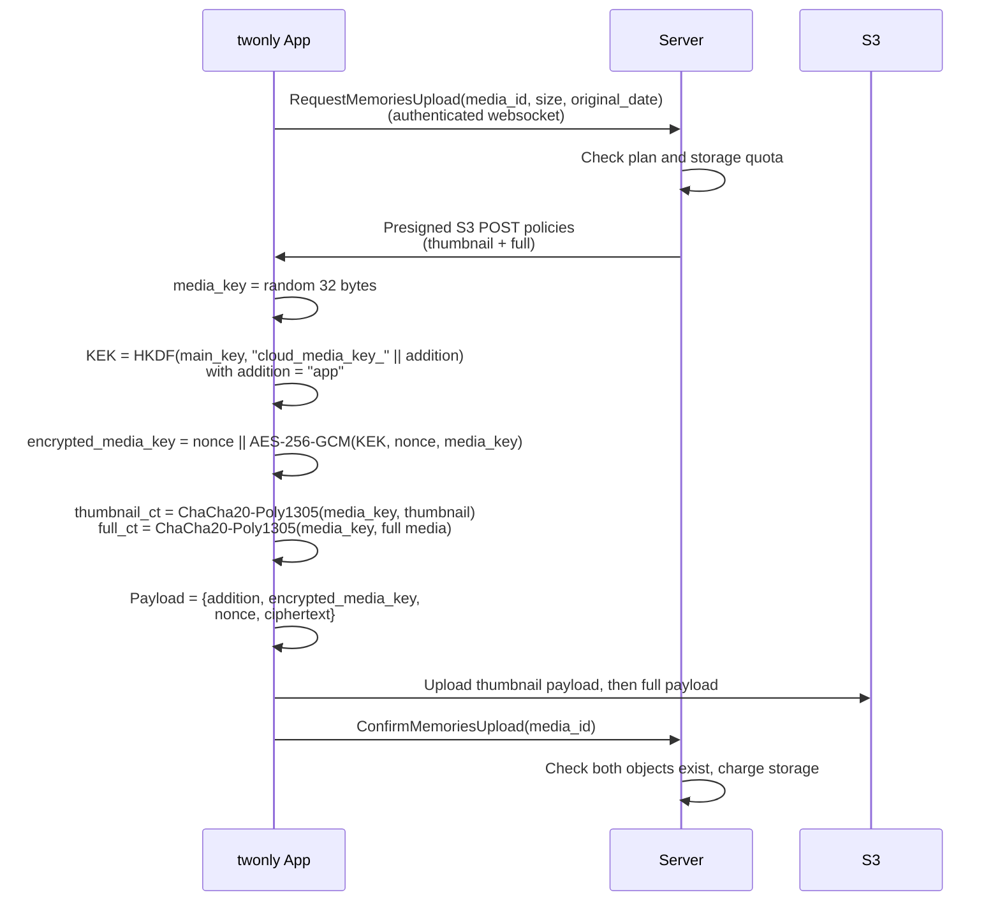
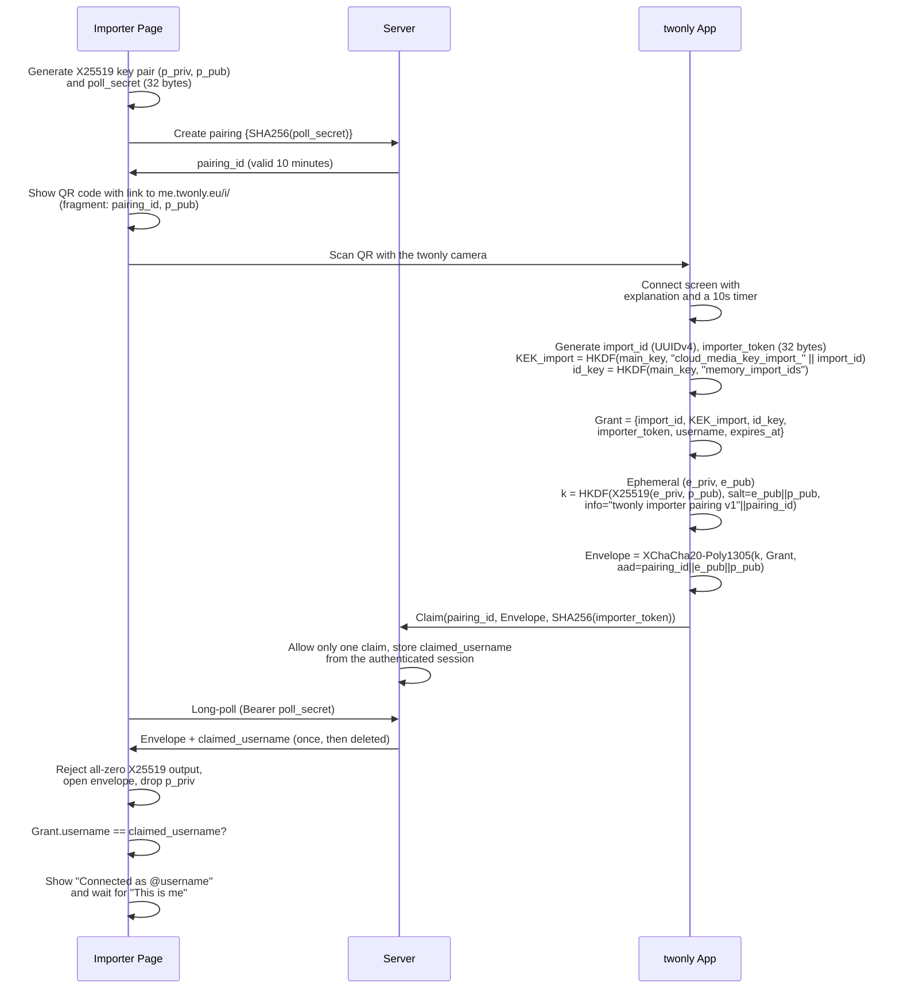
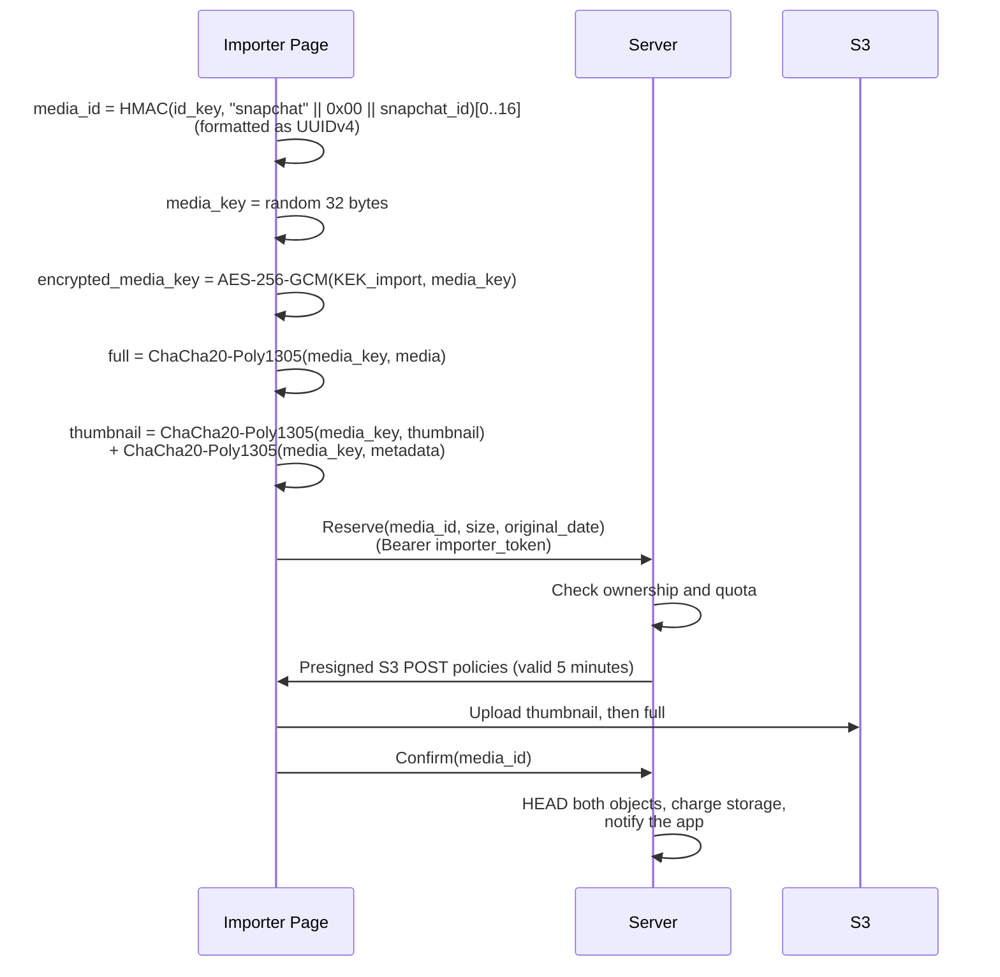

# Importing Snapchat Memories into an End-to-End Encrypted App

This post is about the technical side of the Snapchat import. If you just want to know how to use it, read [Bring Your Snapchat Memories to twonly](https://twonly.eu/en/blog/2026-memories-import.html) on the twonly blog.

An important feature of [twonly](https://twonly.eu), my Open-Source Snapchat alternative, is that users can save their Memories. Once they do, they also want an automatic backup and more space than their phone has. For this, twonly already had an end-to-end encrypted Memories backup, which I describe first in this post.

Several users then asked if they could import their existing Snapchat Memories into it, so I built a Snapchat import. The server must not see the images, so the import runs as a web page on the user's computer. It reads the Snapchat export locally, encrypts every memory in the browser and uploads only ciphertext.

The tricky part is the keys. All memories are protected by keys derived from the user's `main_key`, which only exists in the app, and giving it to a web page would give that page access to everything. So the question was: how can a browser encrypt memories for a user without ever receiving a key that can read, modify or delete anything that already exists?

If you want to try it yourself, the importer is available at [import.twonly.eu](https://import.twonly.eu), and its source code is on [GitHub](https://github.com/twonlyapp/twonly-memories-import).

## End-to-End Encrypted Memories in twonly

Every twonly account has a `main_key`, 32 random bytes generated on the device. All other keys of the account are derived from it with HKDF: the login token, the database keys and the key of the encrypted backup. It is also the key that the encrypted backup and the [passwordless recovery](/blog/2026-passwordless-recovery/) protect, and it never leaves the device in plaintext.

When a memory is backed up, the app encrypts it like this:

Each memory gets its own random `media_key`. The KEK (key encryption key) is a key that only encrypts other keys: it only ever encrypts these 32-byte `media_key`s, and each `media_key` encrypts exactly one memory. The payload stores the wrapped `media_key` together with the `addition` string it was wrapped under. To decrypt a memory, the app downloads the payload, derives the KEK from the `main_key` and the payload's `addition`, unwraps the `media_key` and decrypts the media. The server only stores the ciphertext, the size and the date the memory was taken, which it needs to sort the list.

The importer protocol builds on this `addition` string. The app's own memories always use `app`, but the decryption code accepts any `addition`, since each value just selects a different HKDF derivation of the `main_key`.

## Goals

Before designing the importer protocol, I wrote down what it should achieve:

- The import runs entirely in the browser, so users can upload gigabytes of data from their computer without first copying the export to their smartphone.
- The importer page never receives the `main_key` and cannot decrypt any existing memory, including memories uploaded by an earlier import.
- The importer can only *add* memories. It cannot overwrite, read or delete existing ones.
- The server never sees the plaintext of a memory or its location.

## Pairing the Browser with the App

The page needs two things from the app: a key to encrypt the memories, and permission to upload them into the user's account. To get both, the page shows a QR code that the user scans with the twonly app.

The QR code contains a public key, not a symmetric key. It is shown on a desktop screen, so it could end up in a screen share, a stream or a photo. With a symmetric key, anyone who saw the QR code and later got hold of the ciphertext (the server, for example) could read the grant. This is the full pairing flow:

Only the page that created the pairing knows the `poll_secret`, so only that page can fetch the envelope. The server stores just its hash. The public key sits behind the `#` fragment of the link, so it never reaches any server. The `pairing_id` and both public keys go into the HKDF info and the AEAD's associated data, so nobody can replay an envelope into a different pairing.

### Someone Else Scans My QR Code

An attacker who sees the user's QR code could scan it first with their own account. The page would then upload the user's entire Snapchat export into the attacker's account, encrypted with the attacker's key.

To prevent this, the page shows the username of the account that claimed the pairing and only starts uploading after the user confirms that this is them. The page doesn't take this username from the envelope, which the attacker controls, but from the server, which knows the authenticated session that sent the claim. It also checks that both usernames match. And because the server accepts only one claim per pairing, the legitimate user's app shows "Someone else already scanned this code" if they scan it second.

### Phishing

Phishing works the other way around: an attacker creates a pairing and sends the QR code to a victim, promising a free plan, support or a "verification". If the victim scans it, the attacker can upload into the victim's Memories. As with my [passwordless recovery protocol](/blog/2026-passwordless-recovery/), the defense here is mostly UX:

- The app only accepts pairing links from its own camera. If a link is opened with the system camera or tapped in a chat, the app just tells the user to use the twonly camera. So a link someone sends you cannot start a pairing with one tap.
- In the worst case, the attacker can add memories for at most 2 days. They cannot read, modify or delete anything, and the user can remove the importer together with everything it uploaded.

## Keys that can Only Encrypt

The main idea of the protocol is that the app never sends its `main_key`. Instead, the grant contains keys scoped to exactly what the importer needs:

- `KEK_import = HKDF(main_key, "cloud_media_key_import_" || import_id)`: wraps the per-memory keys of this import.
- `id_key = HKDF(main_key, "memory_import_ids")`: turns a Snapchat ID into a stable twonly media ID.
- `importer_token`: 32 random bytes. The server only stores its SHA-256 hash. It allows uploading into this user's account and nothing else.

`KEK_import` is just the KEK for the `addition` `import_<import_id>` instead of `app`. HKDF with a different info string yields an unrelated key, so `KEK_import` cannot unwrap any memory created by the app or by an earlier import. If it leaks, only the memories of this one import are affected. In the app, the function that exports this key only accepts a typed UUIDv4 and builds the info string itself, so no caller can request the `app` key by accident.

Since every payload names its `addition`, the app needs no new decryption code and no stored state. When it decrypts an imported memory, it derives `KEK_import` from the `main_key` again, the same way it does for its own memories.

The page imports `KEK_import` as a **non-extractable** WebCrypto key that can only `encrypt`, and `id_key` as a non-extractable HMAC key that can only `sign`. Then it zeroes the raw bytes. An attacker who later gets code execution on the page (XSS, or someone using the same browser profile) can still wrap new keys, but cannot read out the keys or unwrap the keys of the memories this import already uploaded.

## Encrypting and Uploading a Memory

For each memory, the page does the following:

This is the same flow the app uses for its own memories, with two differences: the `media_key` is wrapped under `KEK_import` instead of the app's KEK, and the `importer_token` authorizes the upload instead of the app's websocket session. The payload format is byte for byte the same, so imported memories decrypt through the normal path.

The `media_id` is derived from the Snapchat ID, so the same memory always gets the same ID, across page reloads and even across new pairings. If an import is interrupted, the user can run it again with the same export, and the page skips everything that is already uploaded instead of uploading it twice. And since the ID is an HMAC under a key the server doesn't know, the server cannot link it back to Snapchat's IDs. The constant `"snapchat"` prefix keeps the ID spaces of different platforms apart once more importers are added.

The date, location and media type go into a small protobuf message, which is encrypted under the same `media_key` and attached to the thumbnail payload. That way the app can show a memory with its date and location after downloading only the thumbnail. The server learns the date the memory was taken (`original_date`, needed for sorting) and the sizes, but not where it was taken.

### The Importer Cannot Overwrite Anything

The server checks every upload against the `importer_token`. It derives the user and the importer from the token, never from request fields. The "add only" goal is enforced when the page reserves a `media_id`:

- No memory with this `media_id` exists: the server creates a pending row owned by this importer.
- A confirmed memory exists: the server answers `already_uploaded` and issues no upload URL.
- A pending row of another importer or of the app exists: the server answers `ownership_conflict` and issues no upload URL.

So even with a valid token and a known `media_id`, the importer cannot replace a memory the user already has. Upload permissions are presigned S3 policies that expire after 5 minutes, and the server only issues them for a few memories at a time. It checks the storage quota per item, including pending reservations.

The `importer_token` expires after 2 days, or earlier after 2 hours without uploads, so a browser left open on a shared computer doesn't keep access. The page can disconnect itself, and the app lists all connected importers. There the user can remove an importer and choose whether to keep or delete everything it uploaded. Every memory row stores the ID of the importer that created it, so this still works long after the importer itself has been cleaned up.

## Feedback

If you find a flaw in the protocol, I'm all ears: send me an [email](mailto:security@tsmr.eu) or find me on Signal: tobi.02. The source code of the importer is on [GitHub](https://github.com/twonlyapp/twonly-memories-import).
